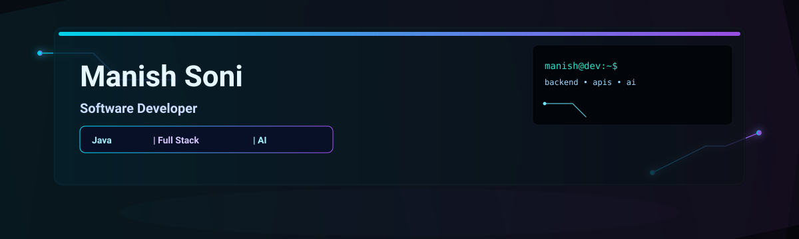
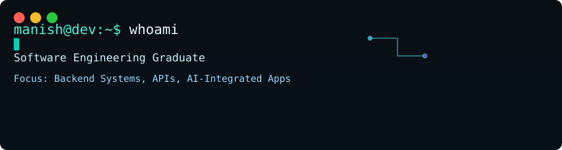

<!--
  AI Developer Command Center profile README
  Theme: premium dark / cyan + purple / terminal-inspired / futuristic
-->

  

  

  

## Overview

<pre><code>manish@dev:~$ whoami
Software Engineering graduate
Focus: backend systems, APIs, AI-integrated apps
Stack: Java • JavaScript • C++ • SQL
Core: React • Node.js • Express.js • MySQL • MongoDB
Cloud fundamentals: Docker • AWS</code></pre>

I build systems that connect product logic, data pipelines, and intelligent workflows. My work centers on backend engineering, clean API design, and AI-powered experiences that feel useful and reliabl[...]

---

## Skills

  

### Core stack

- Java, JavaScript, C++, SQL
- React, Node.js, Express.js, MySQL, MongoDB
- REST APIs, Git, Docker, AWS fundamentals
- AI-integrated application development and backend engineering

---

## Featured projects

### 1) Neura-Chat
<a href="https://github.com/manish23092003/Neura-Chat" target="_blank">https://github.com/manish23092003/Neura-Chat</a>

AI collaborative coding environment.

### 2) AgentFlow
<a href="https://github.com/manish23092003/agentflow" target="_blank">https://github.com/manish23092003/agentflow</a>

AI purchase decision agent built around autonomous procurement workflows.

### 3) Smart Expense Tracker API
<a href="https://github.com/manish23092003/smart-expense-tracker-api" target="_blank">https://github.com/manish23092003/smart-expense-tracker-api</a>

RESTful expense tracking and financial insight API.

### 4) Copy Unlocker
<a href="https://github.com/manish23092003/copy-unlocker" target="_blank">https://github.com/manish23092003/copy-unlocker</a>

Chrome extension focused on improving copy interaction on websites that interfere with normal text selection.

### 5) AI Test Generator
<a href="https://github.com/manish23092003/AI-Test-Generator" target="_blank">https://github.com/manish23092003/AI-Test-Generator</a>

Project in progress; not deployed yet.

---

## GitHub stats

  
  

---

## Working style

- backend-first architecture
- API stability and maintainability
- practical AI product integration
- disciplined Git workflow and clean problem-solving

---

## Contact

- GitHub: <a href="https://github.com/manish23092003" target="_blank">github.com/manish23092003</a>

If you're building AI tools, developer workflows, or backend systems that need practical engineering execution, I’d be glad to connect.

---

  Designed for a premium dark developer profile with a futuristic terminal aesthetic.

